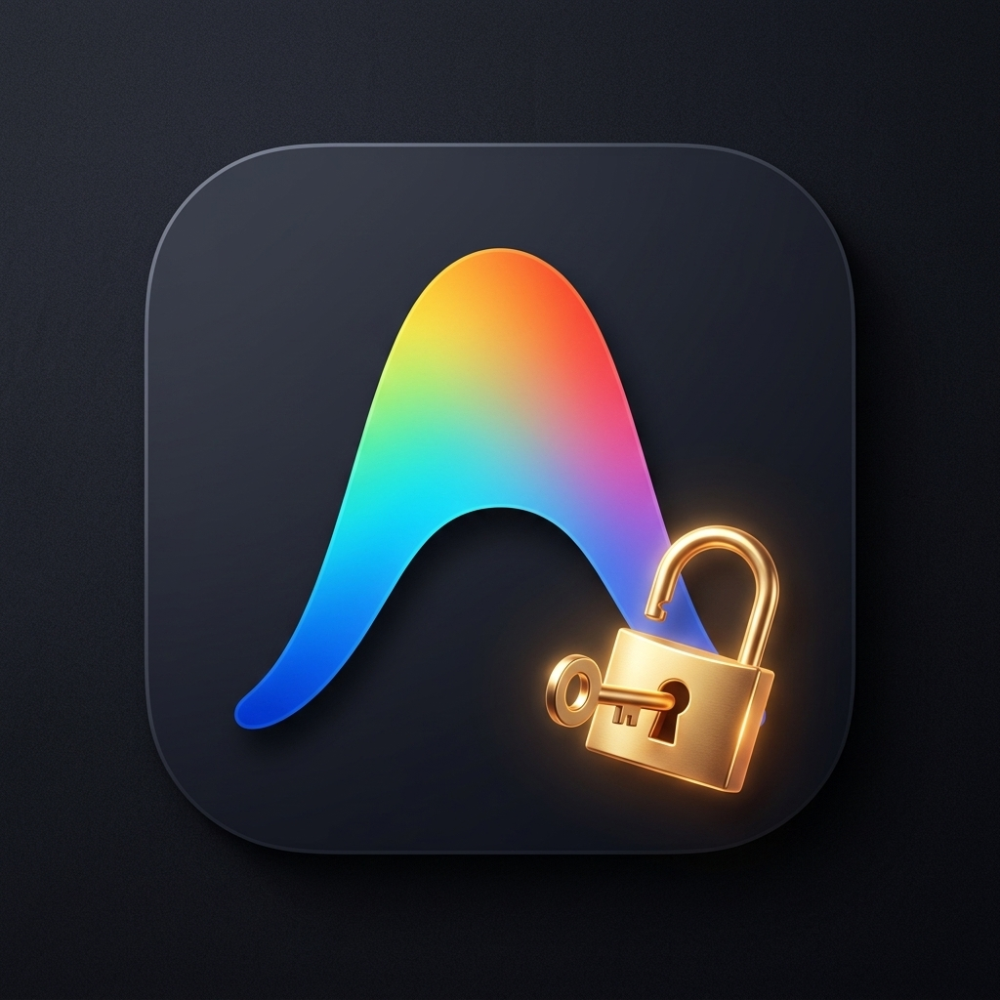
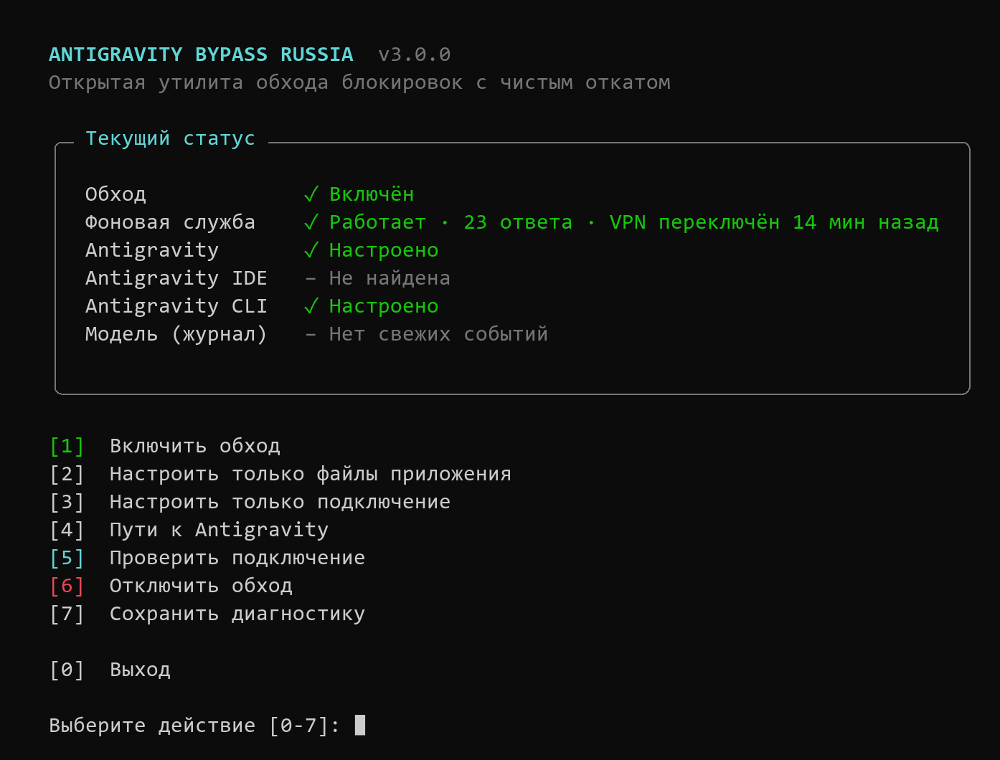

<div align="center">



# Antigravity Bypass Russia

### ⚡ Google Antigravity и Gemini в России — без VPN
**Убирает региональную блокировку одной кнопкой на Windows, macOS и Linux**

[](README.md)
[](README.md)
[-8A2BE2.svg?style=flat-square&logo=rust&logoColor=white)](https://github.com/vezlin1/antigravity-bypass-russia/releases)
[](LICENSE)

<p align="center">
  <a href="#-что-это-такое">О проекте</a> •
  <a href="#-быстрый-старт">Быстрый старт</a> •
  <a href="#-пункты-меню">Меню</a> •
  <a href="#-если-не-работает">Если не работает</a> •
  <a href="#-частые-вопросы">Вопросы</a> •
  <a href="#️-для-продвинутых">Для продвинутых</a>
</p>

</div>

---

## 💡 Что это такое

Утилита убирает ошибки **«User is ineligible»** и **«Location not supported»** в
**Google Antigravity**, **Gemini**, **Antigravity IDE** и расширениях для
**VS Code / Cursor / Windsurf**.

Работает без VPN: всё настраивается одной кнопкой и так же одной кнопкой
убирается. Бесплатно, с открытым кодом.

<br/>

<div align="center">
  
</div>

---

## 🚀 Быстрый старт

### 🪟 Windows 10 / 11

1. Скачайте [**`antigravity-bypass-russia.exe`**](https://github.com/vezlin1/antigravity-bypass-russia/releases/latest).
2. Запустите его двойным кликом и разрешите запуск от имени администратора.
3. Нажмите **`1`** (**Включить обход**) и **Enter**.
4. Когда появится «Готово», откроется Antigravity — войдите в свой Google-аккаунт.

Утилита сама находит Antigravity. Если он установлен в необычную папку, укажите её
в пункте **[4] Пути к Antigravity**.

> [!TIP]
> **Windows пишет «Система Windows защитила ваш компьютер»?**  
> Так Windows встречает новые программы без платного сертификата Microsoft. Нажмите
> *«Подробнее» → «Выполнить в любом случае»*. Исходный код открыт для проверки.

### 🍏 macOS (Apple Silicon и Intel)

1. Откройте **Терминал** и выполните:
   ```bash
   curl -fsSL https://github.com/vezlin1/antigravity-bypass-russia/releases/latest/download/unlock_and_restore.sh -o unlock_and_restore.sh && chmod +x unlock_and_restore.sh && ./unlock_and_restore.sh
   ```
2. Нажмите **`1`** (**Включить обход**) и **Enter**. При необходимости утилита
   спросит пароль администратора.
3. Перезапустите Antigravity, если он был открыт.

<details>
<summary>Скачать скрипт вручную</summary>

Скачайте [**`unlock_and_restore.sh`**](https://github.com/vezlin1/antigravity-bypass-russia/releases/latest)
и запустите его в Терминале:
```bash
chmod +x unlock_and_restore.sh && ./unlock_and_restore.sh
```
</details>

### 🐧 Linux

Подходят Ubuntu 22.04+, Debian 12+ и другие системы того же поколения (x86_64 и ARM64).

1. Выполните в терминале:
   ```bash
   curl -fsSL https://raw.githubusercontent.com/vezlin1/antigravity-bypass-russia/main/scripts/install.sh | bash
   ```
2. Запустите утилиту командой `ag-bypass`.
3. Нажмите **`1`** (**Включить обход**) и **Enter**.

<details>
<summary>Пакет .deb или отдельный файл</summary>

**Пакет `.deb` (Ubuntu, Debian, Linux Mint).** Скачайте
[**`antigravity-bypass-russia-linux-x64.deb`**](https://github.com/vezlin1/antigravity-bypass-russia/releases/latest)
и установите:
```bash
sudo dpkg -i antigravity-bypass-russia-linux-x64.deb
```

**Отдельный файл:**
```bash
# Обычный компьютер (x86_64)
curl -fsSL https://github.com/vezlin1/antigravity-bypass-russia/releases/latest/download/antigravity-bypass-russia-linux-x64 -o antigravity-bypass-russia && chmod +x antigravity-bypass-russia && ./antigravity-bypass-russia

# ARM64 (Raspberry Pi, Asahi Linux, ARM-серверы)
curl -fsSL https://github.com/vezlin1/antigravity-bypass-russia/releases/latest/download/antigravity-bypass-russia-linux-arm64 -o antigravity-bypass-russia && chmod +x antigravity-bypass-russia && ./antigravity-bypass-russia
```
</details>

<details>
<summary>Системные требования Linux</summary>

Готовые сборки требуют glibc 2.35+ и OpenSSL 3. Нужны `iproute2`, `procps`, `psmisc`,
`lsof` и `sudo` или PolicyKit. Перед изменением файлов закройте Antigravity.

Как утилита работает с systemd-resolved и `/etc/resolv.conf`, описано в
[Подробностях](docs/details.md#linux).
</details>

---

## 📋 Пункты меню

| Пункт | Что делает |
|:---:|---|
| **1** | **Включить обход.** Настраивает всё сразу. Начните с него. |
| **2** | Настроить только файлы Antigravity — например, после его обновления. |
| **3** | Настроить только подключение — например, после смены сети или провайдера. |
| **4** | Указать, где установлен Antigravity, если утилита не нашла его сама. |
| **5** | Проверить, есть ли связь с серверами Google. |
| **6** | **Отключить обход** и вернуть всё как было. |
| **7** | Сохранить файл диагностики для обращения в поддержку. |
| **0** | Выход. |

---

## 🆘 Если не работает

1. Выберите **[5] Проверить подключение**. Утилита покажет, с какими серверами нет
   связи, и подскажет, что сделать.
2. Закройте Antigravity и выберите **[1] Включить обход** ещё раз.
3. Не помогло? Выберите **[7] Сохранить диагностику** и
   [создайте обращение](https://github.com/vezlin1/antigravity-bypass-russia/issues/new),
   приложив этот файл. В нём нет паролей, токенов и текстов переписок.

Если утилита показала ошибку, в ней уже написано, что случилось и что сделать.
Расшифровка технических причин — в [Подробностях](docs/details.md).

---

## ❓ Частые вопросы

<details>
<summary><b>Нужен ли VPN?</b></summary>
<p>
Нет. Утилита рассчитана на домашнюю или мобильную сеть. Доступность зависит от
провайдера и прав Google-аккаунта.
</p>
</details>

<details>
<summary><b>Безопасно ли это для Google-аккаунта и системы?</b></summary>
<p>
<b>Абсолютно безопасно.</b> Проект полностью Open Source. Программа не крадёт токены,
не подменяет SSL-сертификаты и не отправляет личные данные. Исходный код доступен для
независимого аудита в этом репозитории.
</p>
</details>

<details>
<summary><b>Замедлится ли интернет или онлайн-игры?</b></summary>
<p>
Нет. Утилита меняет путь только для сервисов Google AI, остальной трафик идёт как
раньше. Скорость самого Antigravity зависит от нагрузки на сервис и модели.
</p>
</details>

<details>
<summary><b>Antigravity обновился и снова пишет про регион</b></summary>
<p>
Запустите утилиту и выберите пункт <b>1</b> ещё раз.
</p>
</details>

<details>
<summary><b>При входе бесконечная загрузка</b></summary>
<p>
Закройте Antigravity и выберите пункт <b>1</b> ещё раз: утилита сбросит устаревший
кэш сессий. Если не помогло, проверьте связь пунктом <b>5</b>.
</p>
</details>

<details>
<summary><b>У меня включён VPN — работают ли веб-версии Gemini и AI Studio?</b></summary>
<p>
Пока VPN включён, они открываются через него. Когда вы отключите VPN, утилита на
Windows сама включит для них обход — перезапускать её не нужно. На сам Antigravity
VPN не влияет.
</p>
</details>

<details>
<summary><b>Как всё удалить?</b></summary>
<p>
Выберите пункт <b>[6] Отключить обход</b>. Утилита вернёт исходные файлы Antigravity
и прежние сетевые настройки. Настройки, которые вы меняли сами, она не трогает.
Что именно восстанавливается — в <a href="docs/details.md#что-делает-откат">Подробностях</a>.
</p>
</details>

---

## 🛠️ Для продвинутых

<details>
<summary><b>Как это работает и технические подробности</b></summary>

Через локальный DNS-релей идут только запросы к серверам Google AI, а проверка
страны в Antigravity снимается локальным патчем. Всё работает на вашем компьютере.

Подробно — в [docs/details.md](docs/details.md): поддерживаемые клиенты, работа с VPN,
резервный сервер daily, расшифровка ошибок маршрута, состав отката, Linux.
DNS-провайдеры и `network.json` — в [docs/network-providers.md](docs/network-providers.md).
</details>

<details>
<summary><b>Windows: запуск через PowerShell без .exe</b></summary>

1. Скачайте [архив проекта](https://github.com/vezlin1/antigravity-bypass-russia/archive/refs/heads/main.zip)
   и распакуйте его.
2. Запустите **PowerShell от имени администратора**, перейдите в папку проекта и выполните:
   ```powershell
   Set-ExecutionPolicy -Scope Process -ExecutionPolicy Bypass
   .\scripts\unlock_and_restore.ps1
   ```
3. В меню выберите пункт **`1`**.
</details>

<details>
<summary><b>macOS и Linux: запуск из исходников</b></summary>

Нужен **Rust** (`cargo`). На Linux сначала установите зависимости:
```bash
# Ubuntu / Debian
sudo apt install build-essential pkg-config libssl-dev lsof iproute2 procps psmisc

# Fedora
sudo dnf install gcc pkgconf-pkg-config openssl-devel lsof iproute procps-ng psmisc

# Arch Linux
sudo pacman -S base-devel openssl lsof iproute2 procps-ng psmisc
```

Затем:
```bash
git clone https://github.com/vezlin1/antigravity-bypass-russia.git
cd antigravity-bypass-russia
chmod +x scripts/unlock_and_restore.sh
./scripts/unlock_and_restore.sh
```
Запускайте без `sudo`: скрипт сам соберёт утилиту и запросит права администратора
только там, где они нужны.

Для Arch Linux и Manjaro есть [`packages/arch/PKGBUILD`](packages/arch/PKGBUILD)
(`makepkg -si`).
</details>

<details>
<summary><b>Сборка из исходников</b></summary>

```bash
git clone https://github.com/vezlin1/antigravity-bypass-russia.git
cd antigravity-bypass-russia
cargo build --release
```
Готовый файл появится в `target/release/`.
</details>

<details>
<summary><b>Команды для терминала</b></summary>

`antigravity-bypass-russia --help` покажет все команды. Основные: `unlock`
(включить обход), `rollback` (отключить), `status`, `diagnostics` (проверить связь)
и `report` (сохранить диагностику).
</details>

---

## 🙏 Благодарности

Проект вдохновлён наработками и идеями [confeden/Antigravity](https://github.com/confeden/Antigravity).

---

## ⚖️ Лицензия и отказ от ответственности

- Проект распространяется под свободной лицензией **[MIT License](LICENSE)**.
- Все товарные знаки, названия и логотипы (*Google, Antigravity, Gemini, VS Code, Cursor, Windsurf*) принадлежат их законным правообладателям.
- Проект создан исключительно в исследовательских и образовательных целях для обеспечения совместимости инструментов разработки.
