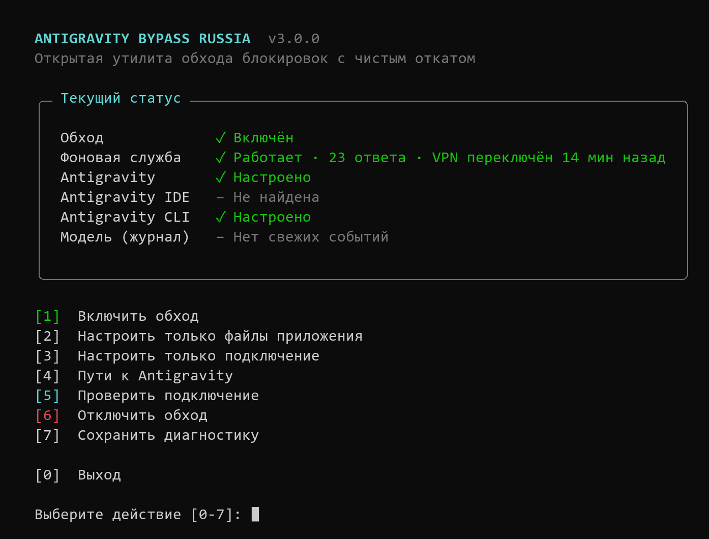

# 🚀 Antigravity Bypass Russia 3.0.0

**Самое большое обновление: утилита стала понятнее, надёжнее, быстрее и сама подстраивается под VPN.**

  

## ✨ Что нового

### 🗣️ Понятно с первого взгляда
Утилита больше не говорит на языке сетевых инженеров. Настройка идёт по шагам —
«2 из 5: проверяем связь с серверами Google», — а в конце один ясный итог:
**«Готово — обход включён»** и что делать дальше. Если что-то пошло не так, вы
увидите причину и совет, как это исправить, а не код ошибки. Все экраны в одном
стиле и подстраиваются под ширину окна.

### 🌐 Подключение стало надёжнее
- **Защищённый DNS.** Встроенные DNS-серверы теперь работают через зашифрованный
  DoH. Устаревший сервер GeoHide RU убран.
- **Выбирается рабочий адрес, а не самый быстрый.** Если серверы прислали разные
  ответы, утилита берёт тот, через который Antigravity действительно работает.
- **Вторая попытка.** Если сервер Google не ответил с первого раза, утилита через
  3 секунды проверит его ещё раз со свежими данными.
- **Резервный сервер.** Если основной сервер Antigravity недоступен из вашей сети,
  настройка не прерывается: Antigravity сам переходит на резервный
  (на Windows и macOS — приложение, IDE и CLI).
- **Понятные ошибки маршрута.** Если адрес так и не нашёлся, утилита скажет, на каком
  этапе связь оборвалась, и что с этим делать.
- **Обновление ничего не ломает.** Если новая версия фоновой службы не прошла
  проверку, остаются прежние рабочие настройки.

Если у вас была ошибка «Не удалось завершить настройку подключения» — попробуйте
эту версию.

### 🔄 Дружит с VPN (Windows)
- Утилита следует за VPN: включили или выключили его — подключение
  перестраивается само, перезапускать ничего не нужно.
- Веб-версии Gemini и AI Studio при включённом VPN работают через него, а после
  отключения VPN за несколько секунд переходят на обход.
- Если VPN мешает настройке, Antigravity запускается через резервный канал.
- Больше никаких внезапно открывающихся окон Chrome.

### ⚡ Быстрее и легче
- Главный экран открывается быстрее: проверка статуса больше не копирует файлы
  Antigravity по 100 МБ.
- Фоновая служба не запускает PowerShell каждые несколько секунд, пока включён
  VPN, и не перечитывает настройки на каждый запрос.
- Настройка проверяет серверы одновременно, а не по очереди. Проверка подключения
  и сохранение диагностики тоже стали быстрее.

### 💪 Фоновая служба, которая не падает
На главном экране видно, работает ли служба, сколько запросов она обработала и
когда последний раз переключалась после смены VPN. Если служба вдруг остановится,
Windows сама её перезапустит. Соединения с серверами держатся дольше, а
популярные адреса обновляются заранее, поэтому после паузы ждать ответа меньше.

### 📁 Удобнее с нестандартной установкой
- Пункт **[4] Пути к Antigravity** перед сохранением показывает, что нашёл, и
  спрашивает подтверждение. Ошибочно добавленный путь можно убрать прямо из меню,
  а папку другой программы утилита просто не примет. [#33](https://github.com/vezlin1/antigravity-bypass-russia/issues/33)
- На Windows Antigravity находится и тогда, когда установлен только для вашего
  пользователя или в бета-версии.

## 🐞 Исправлено
- Строка «Antigravity IDE» больше не показывает «Нужна проверка» без причины.
- Пункт **[5]** больше не показывает старые «отказы по региону» из прошлых версий.
- Диагностика отличает отсутствие лицензии от исчерпанного лимита запросов.
- Окно «Нужно закрыть Antigravity» называет программы, а не перечисляет десяток
  номеров процессов.
- При остановке службы утилита больше не может задеть посторонний процесс,
  получивший тот же номер.
- И много мелких исправлений стабильности.

## ⬆️ Как обновиться
1. Скачайте файл для своей системы из списка ниже.
2. Запустите его и нажмите **`1`** (**Включить обход**). Это обязательно: так
   обновится фоновая служба и заработают новые функции.
3. Что-то пошло не так? Пункт **`6`** вернёт всё как было.

Ваши настройки из 2.5.0 сохраняются. Если вы вручную оставляли только сервер
GeoHide RU, выберите другой DNS-сервер — этот больше не поддерживается.

Если не работает, выберите **`7`** и [создайте обращение](https://github.com/vezlin1/antigravity-bypass-russia/issues/new)
с этим файлом — так мы быстрее разберёмся.

## 📦 Файлы для загрузки

| Система | Файл |
|---|---|
| Windows 10 / 11 | `antigravity-bypass-russia.exe` |
| Windows, через PowerShell | `unlock_and_restore.ps1` |
| macOS (Apple Silicon и Intel) | `unlock_and_restore.sh` |
| Linux x86_64 | `antigravity-bypass-russia-linux-x64` |
| Linux ARM64 | `antigravity-bypass-russia-linux-arm64` |
| Debian / Ubuntu x86_64 | `antigravity-bypass-russia-linux-x64.deb` |
| Linux, автоустановка | `install.sh` |

<b>📋 Подробный список изменений</b>

### Понятный интерфейс
- Экраны говорят простыми словами: «связь с серверами Google», «фоновая служба», «резервный канал» вместо DNS, TLS/HTTP, релея и CONNECT. Технические подробности по-прежнему пишутся в журнал.
- Пункты [1], [3] и [6] показывают шаги вида «2/5 Проверяем связь с серверами Google» со спиннером и временем. Готовый шаг остаётся одной строкой с ✓ или ✗, результаты по файлам — под шагом.
- В конце один итог: «Готово — обход включён», «…но есть замечания» или «…не включён», строка «Что дальше» и замечания простыми словами вместо внутренних предупреждений.
- Ошибки оформлены как «Причина» и «Что сделать»: для занятого файла, нехватки прав, ошибки в пути, неподдерживаемой версии, отсутствия интернета, занятого порта DNS и неответивших серверов Google. Коды вроде `(os error 5)` не показываются.
- Единый стиль всех экранов: одна рамка, одни значки (✓ ! ✗ –), цвета по смыслу. Ширина подстраивается под окно консоли (44–76 символов). При выводе в файл или с `NO_COLOR` цвета отключаются.
- Перед закрытием Antigravity утилита называет открытые программы («Antigravity (11 процессов), служебный процесс Antigravity») вместо списка PID, а кнопка говорит, что произойдёт: «Закрыть Antigravity и отключить обход».

### Gemini и AI Studio при VPN
- Отдельный Chrome для Gemini и AI Studio больше не открывается, команда `--connect-launch web` удалена. Профиль Chrome от прежних версий удаляется при следующем запуске пункта [1] или [6].
- На Windows фоновая служба сама следует за VPN. Если VPN блокирует локальный DNS утилиты, веб-версии Gemini и AI Studio при включённом VPN работают через него, а после отключения VPN служба в течение нескольких секунд включает для них обход. При повторном включении VPN эти сайты снова передаются ему. Перезапускать утилиту не нужно.

### Фоновая служба
- Главный экран показывает строку «Фоновая служба»: работает ли она, сколько ответила и когда последний раз переключалась после смены VPN.
- Задача планировщика перезапускает службу после сбоя до 999 раз, раз в 5 минут проверяет, что она работает, и запускает её с обычным приоритетом вместо пониженного. Во время обновления службы проверка не мешает замене файлов.
- Соединения с DoH-серверами держатся 90 секунд, популярные ответы обновляются заранее, до истечения срока. Пачку изменений маршрутов от VPN служба пережидает и проверяет сеть один раз. Потоки для запросов используются повторно.

### Пути к Antigravity и статус
- Пункт [4] называется «Пути к Antigravity». Перед сохранением он показывает найденные компоненты и их состояние и просит подтверждения. Сохранённый путь можно убрать; если в установке остались настроенные файлы, утилита предложит сначала вернуть исходные.
- Папки других приложений на Electron и VS Code (Slack, Discord и т. п.) больше не принимаются за Antigravity.
- Строка «Antigravity IDE» больше не показывает «Нужна проверка» из-за архива обычного приложения Antigravity, в котором нет кода IDE.

### Документация
- README переписан для тех, кто не разбирается в сетях: короткий быстрый старт, таблица пунктов меню и раздел «Если не работает». Технические подробности перенесены в `docs/details.md`.

### Остальные изменения

- DNS-AI и GeoHide EU работают через DoH. Встроенный GeoHide RU UDP удалён. Пользовательские UDP-серверы можно задать в `extra_udp`.
- Для доменов Agent пригодный ответ другого bootstrap-адреса того же DoH-провайдера получает приоритет над быстрым ответом без подходящего адреса. В резервных правилах сохраняются оба адреса настроенного UDP-провайдера.
- Обновление сохраняет действующие DNS-правила и `hosts`, если новый релей не проходит проверку. Состояние DNS для Agent и браузерных сервисов проверяется отдельно.
- Настройка прерывается с сохранением прежних маршрутов, если недоступен daily. Если из сети недоступен только обычный Cloud Code, настройка завершается, а клиенты переключаются на daily: на Windows и macOS App, IDE и CLI, на Linux только IDE. [#32](https://github.com/vezlin1/antigravity-bypass-russia/issues/32)
- На macOS App и CLI переходят на daily через `CLOUD_CODE_URL`: сеанс пользователя, LaunchAgent и блок в `~/.zshenv`. Откат удаляет только добавленное.
- Домены, не прошедшие проверку, проверяются повторно через 3 секунды со свежим ответом DNS. Ошибка подбора маршрута называет этап, на котором не прошла проверка (DNS, TCP, TLS, сертификат, HTTP), и даёт совет для него.
- Формат `network.json` совместим с v2.5.0. Для конфигураций, которые использовали только удалённый встроенный UDP, нужно выбрать провайдера.
- Диагностика различает отсутствие лицензии и исчерпание лимита запросов в журналах клиента.
- Пункт [4] сохраняет указанный путь к Antigravity для следующих запусков. Для папки Gemini Desktop выдаётся понятная ошибка. [#33](https://github.com/vezlin1/antigravity-bypass-russia/issues/33)
- На Windows Antigravity App, IDE и CLI также ищутся по установочным записям пользователя и всей системы, в том числе с пометками вроде «(User)», «(x64)» и версиями с суффиксом `-beta`. Пути с переменными чужого профиля (`%TEMP%`, `%HOMEPATH%`) пропускаются.
- На Windows пункты [1] и [3], а также команды `unlock` и `dns`, следуют маршрутам Windows при смене VPN. Фоновая служба обновляет DNS-кэш и проверяет резервные адреса Antigravity.
- Пункт [1] на Windows запускает Antigravity с автоматическим запасным CONNECT при блокировке локального DNS.
- При отключённом UAC и во встроенной учётной записи Администратора пункт [1] запускает CONNECT в сеансе текущего профиля Windows.
- Пункт [5] больше не показывает устаревшие «региональные отказы» из таблицы маршрутов прежних версий. Таблица удалена, её файл `route-health.json` удаляется при откате, раздел `route_health` исключён из `report`. Отказы модели по-прежнему видны в строке «Модель».
- Удалено восстановление TCP backup версий 1.x, у которого не было пункта меню. Команда `tune` при найденном `tcp_backup.conf` объясняет, как сбросить TCP вручную.

Для проверки официальных сборок Linux x64 закреплены две версии каждого клиента.
Текущие версии: App 2.34.0, IDE 2.8.0 и CLI 1.5.13. Предыдущие: App 2.32.2,
IDE 2.7.0 и CLI 1.5.10. Отдельная ежедневная проверка сообщает об изменениях
на странице загрузок Google и в манифестах CLI. [Архив Google Antigravity](https://antigravity.google/releases)

### Для разработчиков

- Хук `.githooks/pre-push` проверяет отправляемый коммит: `cargo check`, модульные тесты и проверки самой программы (`tests/cli.rs`). Включается командой `git config core.hooksPath .githooks`.
- Удалены 121 тест, которые не обращались к коду программы (набор e2e и `socket_tests`). Их место в CI заняли проверки собранной программы: справка, версия и отказ на неизвестные команды.
- CI выполняет задания параллельно с одной сборкой на ОС, пропускает Rust-задания для изменений только в документации, а релиз собирается из прошедшего прогона проверок вместо повторного тестирования.
- `verify_release.py` проверяет новую панель статуса: ровную правую границу при любой ширине и все подписи.
- Код отформатирован `rustfmt`, `.gitignore` сокращён до путей проекта.

**Full Changelog**: https://github.com/vezlin1/antigravity-bypass-russia/compare/v2.5.0...v3.0.0
